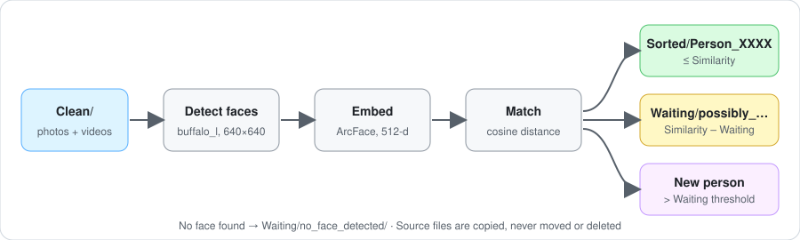
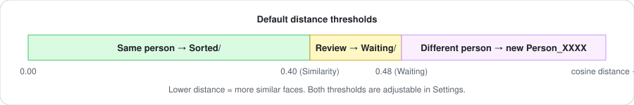

<div align="center">

# ArcFace Dataset Sorter

**Local server for sorting photos and videos into per-person folders with ArcFace face matching.**


[ภาษาไทย](README.md) · **English**

</div>

---

## Table of Contents

[Local Server & Compute](#local-server--compute) · [License](#license) · [Changelog](#changelog) · [Introduction](#introduction) · [Quick Start](#quick-start) · [Advanced Settings](#advanced-settings) · [Credits](#credits)

---

## Local Server & Compute

Everything runs on your own machine. No image, video or face data is sent anywhere.

| | |
|---|---|
| **Server** | Flask, `http://localhost:5000` (port 5000) |
| **Network binding** | `0.0.0.0` — reachable by other machines on the same network |
| **Authentication** | None |
| **Model** | InsightFace `buffalo_l` (detection + ArcFace recognition), downloaded on first run |
| **Inference** | ONNX Runtime — tries CUDA (NVIDIA GPU) first, falls back to CPU |
| **Processing** | One file at a time (no parallelism) |
| **RAM** | At most 20 embedding samples per person (~40 KB per person) |
| **Video cost** | ~10 decoded frames per clip, independent of clip length |
| **Disk** | Source files are **copied**, so plan for about as much free space as the data you process |
| **State** | `.face_db/` (embeddings, processed-file index) and `.thumbnails/`, saved every 10 files |
| **Speed** | Not benchmarked — depends on GPU/CPU and file count. Try a small subset first |

> **Security:** the server has no login and listens on all interfaces. Run it only on a trusted network.
> **Privacy:** `.face_db/` and `.thumbnails/` contain biometric data. Never publish them (already in `.gitignore`).

---

## License

The code in this repository is released under the [MIT License](LICENSE).

The MIT License **does not cover the model**. Models downloaded through InsightFace have their own terms
(as understood, research / non-commercial use). **Check the latest terms in the
[InsightFace repository](https://github.com/deepinsight/insightface) before any commercial use.**

---

## Changelog

### 2026-10-19 — v1.0.0

**Added**
- Face detection and embedding with InsightFace `buffalo_l` (ArcFace), CUDA with CPU fallback
- Sorting of photos and videos into `Sorted/Person_XXXX/`, with a `Waiting/` folder for uncertain matches and files without faces
- Video support: frames sampled from the start of each clip, repeated faces within a clip merged into one person
- Persistent person database and processed-file index; stop and resume without redoing work
- Web UI: live progress, settings, person list with thumbnails, rename and merge
- Windows helper scripts `INSTALL.bat` and `START.bat`
- English and Thai documentation, MIT license

**Changed**
- Web UI text translated to English

---

## Introduction

**ArcFace Dataset Sorter** organizes an image/video collection by *who appears in it*.
It is built for small-to-mid-size collections (roughly **1–2 TB**) that have **already been curated and cleaned**:
faces are reasonably clear, and a person can review the `Waiting/` folder afterwards.

It is a pipeline and web UI on top of a pre-trained model. It does not train or ship its own model.



**How it works**

1. Reads files from `Clean/` (top level only — **subfolders are not scanned**) and skips files already processed.
2. Detects faces and builds a 512-dimensional ArcFace embedding for each.
3. Compares each embedding with the person database using cosine distance and sorts the file:
   - close enough → `Sorted/Person_XXXX/`
   - borderline → `Waiting/possibly_Person_XXXX/`
   - too far → a new person is created
   - no face found → `Waiting/no_face_detected/`
4. Videos: frames are sampled from the beginning of the clip; repeated faces in the same clip count as one person.
5. Source files are **copied, never moved or deleted**.

**Good fit:** curated datasets, clear faces, batch runs, someone to review `Waiting/`.
**Not a good fit:** CCTV, very small or blurry faces, real-time use, or identity verification.

**Supported formats**
Images: JPG, JPEG, PNG, BMP, WEBP, GIF · Videos: MP4, AVI, MOV, MKV, WMV, FLV, WEBM

---

## Quick Start

**Requirements:** Python 3 and the packages in `requirements.txt` (InsightFace, ONNX Runtime, OpenCV, NumPy, Flask, …).
An NVIDIA GPU is optional.

### Windows
1. Double-click `INSTALL.bat` (installs Python 3.11 via winget if missing, then the dependencies)
2. Double-click `START.bat`
3. Open http://localhost:5000

### Linux / macOS
```bash
pip install -r requirements.txt
python app.py
```
Then open http://localhost:5000. The "open folder" buttons call `explorer` and only work on Windows;
everything else is cross-platform (not tested on other systems).

### Use it
1. Put curated photos/videos directly in `Clean/` (no subfolders).
2. Press **Start** and watch the live progress.
3. Review results:

```
Clean/    ← input
Sorted/   ← one folder per person (rename or merge from the web UI)
Waiting/  ← uncertain files for manual review
```

Stopping and starting again continues where you left off.

---

## Advanced Settings

Change settings in the **Settings** tab or with `POST /api/settings`. Changes apply from the next file.



| Setting | Default | Description |
|---|---|---|
| Similarity Threshold | 0.40 | Max cosine distance to count as the same person. Lower = stricter (suggested 0.35–0.45) |
| Waiting Threshold | 0.48 | Beyond this a face is a new person; between the two thresholds the file goes to Waiting |
| Min Face Confidence | 0.70 | Minimum detector confidence for a face |
| Video Scan Length | 20 s | Only the start of each clip is scanned (suggested 10–20) |
| Video Frame Interval | 2.0 s | One sampled frame every N seconds, ≈10 frames per clip (suggested 1–3) |

Constants in `face_recognizer.py`: `MIN_FACE_SIZE` (50 px), `SAVE_EVERY_N_FILES` (10).
After changing thresholds, call `POST /api/reset-processed` to rescan everything.

**HTTP API**

| Endpoint | Purpose |
|---|---|
| `POST /api/start`, `POST /api/stop` | Start / stop processing |
| `GET /api/status` | Progress, statistics and log |
| `GET /api/persons` | List persons |
| `POST /api/persons/<id>/rename` | Rename a person |
| `POST /api/persons/merge` | Merge two persons |
| `GET /api/thumbnail/<id>` | Face thumbnail |
| `GET /api/folders` | Folder listing |
| `GET` / `POST /api/settings` | Read / change settings |
| `POST /api/reset-processed` | Forget processed files |
| `GET /api/stats/summary` | Summary counts |

Logs are written to `face_recognition.log` and to the console.

---

## Credits

- **[InsightFace](https://github.com/deepinsight/insightface)** — library and the `buffalo_l` (ArcFace) model used for detection and embeddings
- **ArcFace** — Deng et al., *ArcFace: Additive Angular Margin Loss for Deep Face Recognition*, CVPR 2019
- [ONNX Runtime](https://onnxruntime.ai/) · [OpenCV](https://opencv.org/) · [NumPy](https://numpy.org/) · [Flask](https://flask.palletsprojects.com/) · [Pillow](https://python-pillow.org/)
